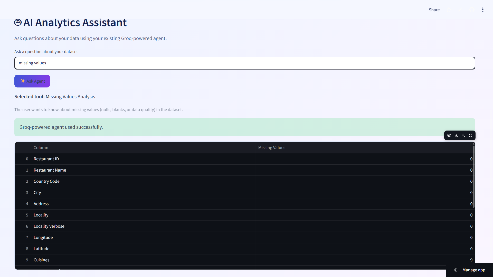
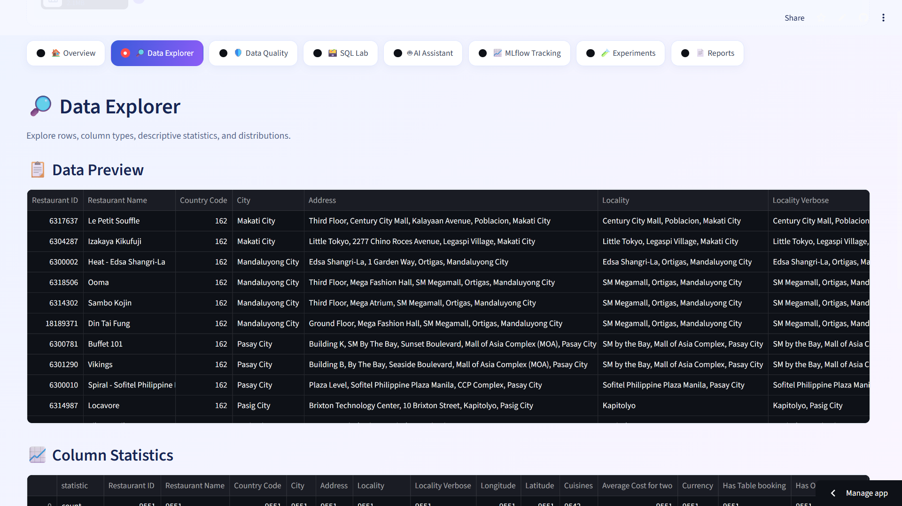
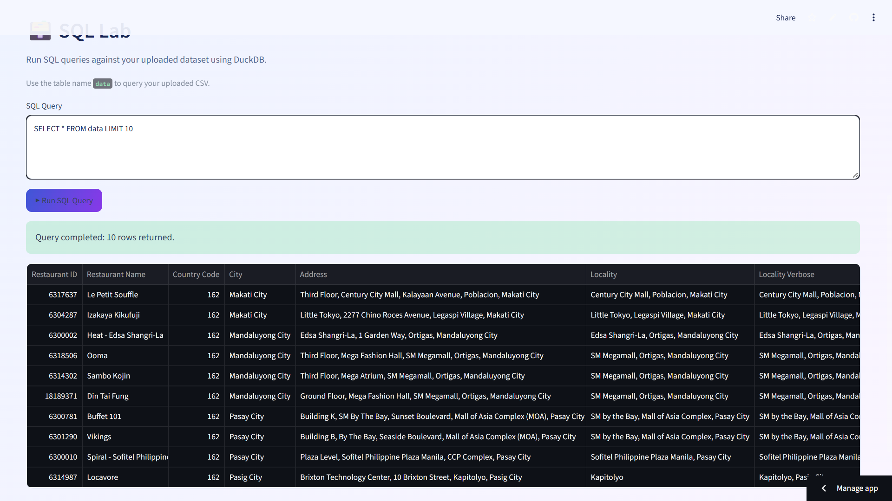

# 📊 AI Data Analytics Agent

**An AI-assisted data analytics platform built with Python, Streamlit, FastAPI, Polars, DuckDB, Plotly, and MLflow.**

Upload CSV datasets, explore data quality, run SQL queries, ask natural-language questions, generate downloadable reports, and track analysis experiments with MLflow.

<p align="center">
  <a href="https://www.python.org/"></a>
  <a href="https://streamlit.io/"></a>
  <a href="https://fastapi.tiangolo.com/"></a>
  <a href="https://mlflow.org/"></a>
  <a href="https://github.com/Nagulanvelu/ai-data-analytics-agent/actions/workflows/ci.yml"></a>
  <a href="https://www.docker.com/"></a>
</p>

## 📌 Table of Contents

- [Overview](#-overview)
- [Features](#-features)
- [Technology Stack](#-technology-stack)
- [Architecture](#-architecture)
- [Project Structure](#-project-structure)
- [Getting Started](#-getting-started)
- [Environment Configuration](#-environment-configuration)
- [Run the Application](#-run-the-application)
- [MLflow Experiment Tracking](#-mlflow-experiment-tracking)
- [REST API](#-rest-api)
- [Testing and CI](#-testing-and-ci)
- [Docker](#-docker)
- [Future Improvements](#-future-improvements)
- [Author](#-author)

## 🎯 Overview

AI Data Analytics Agent brings essential exploratory data analysis and data-quality workflows into one interactive application.

It combines CSV profiling, data-quality checks, SQL analytics, interactive visualizations, AI-assisted question answering, downloadable reports, and MLflow experiment tracking.

The goal is to make dataset exploration easier while providing reproducible records of data-quality analysis.

## 🌐 Live Demo

Try the deployed application: **[🚀 Launch DataWizard AI](https://datawizard-ai.streamlit.app/)**

## 🖼️ Application Screenshots

### Data Explorer


### AI Analytics Assistant


### SQL Lab


---

## ✨ Features

### 📂 CSV Data Profiling
- Upload CSV files through an interactive Streamlit dashboard.
- Explore dataset dimensions, columns, and data types.
- Preview records and inspect descriptive statistics.
- Process tabular data with Polars.

### 🧹 Data Quality Analysis
- Identify missing values by column.
- Detect duplicate records.
- Inspect blank values in supported text columns.
- Visualize missing-value patterns.
- Generate downloadable data-quality reports.
- Calculate a project-defined data-quality score.

### 📊 Interactive Visualizations
- Explore numeric distributions with Plotly.
- Visualize missing-value information.
- Review analytical results directly in the dashboard.

### 🗃️ SQL Analytics
- Query uploaded CSV data using DuckDB.
- Preview query results.
- Download query results as CSV.

Example query:

```sql
SELECT * FROM data LIMIT 10;
```

### 🤖 AI-Assisted Analytics Agent
- Ask natural-language questions about your dataset.
- Route supported questions to analytics tools.
- Use the configured Groq-powered workflow when available.
- Display the selected tool and analysis results.

The questions supported depend on the analytics tools and configuration in the application.

### 📝 Automated Reports
- Generate text-based data-quality reports.
- Include dataset dimensions and quality findings.
- Summarize missing values, duplicate rows, and numerical statistics.
- Download reports for further review.

### 📈 MLflow Experiment Tracking
- Track dataset-analysis runs with MLflow.
- Record dataset dimensions and column counts.
- Log missing-value and duplicate-row metrics.
- Track missing and duplicate percentages.
- Log the project-defined data-quality score.
- Save generated reports as MLflow artifacts.
- Return an experiment run ID for inspection.

### 📊 Experiment Comparison
- Retrieve historical MLflow experiment runs.
- Compare logged data-quality metrics.
- Review quality-score changes across analysis runs using the dashboard's comparison functionality.

### ⚡ REST API
- Provide CSV-analysis functionality through FastAPI.
- Generate analysis reports through API endpoints.
- Expose interactive API documentation through Swagger UI.

### 🧪 Automated Testing and CI
- Test application components using pytest.
- Measure test coverage using pytest-cov.
- Run automated tests through GitHub Actions for configured pushes and pull requests.

### 🐳 Docker Support
- Build a container image using the included Dockerfile.
- Configure application ports for dashboard and API access according to the container setup.

## 🛠️ Technology Stack

| Technology | Purpose |
|---|---|
| Python | Application logic |
| Streamlit | Interactive analytics dashboard |
| FastAPI | REST API |
| Polars | Data processing and profiling |
| DuckDB | SQL analytics |
| Plotly | Interactive visualizations |
| LangGraph | Analytics-agent workflow |
| Groq | Configured LLM-powered question answering |
| MLflow | Experiment tracking and artifact logging |
| Pytest | Automated testing |
| pytest-cov | Test coverage |
| GitHub Actions | Continuous integration |
| Docker | Containerization |

## 🏗️ Architecture

```text
                     ┌──────────────────────┐
                     │        User          │
                     └──────────┬───────────┘
                                │
                     ┌──────────▼───────────┐
                     │ Streamlit Dashboard  │
                     └──────────┬───────────┘
                                │
              ┌─────────────────┼─────────────────┐
              │                 │                 │
     ┌────────▼────────┐ ┌──────▼──────┐ ┌────────▼────────┐
     │ Polars Profiling│ │ DuckDB SQL  │ │ Plotly Charts   │
     └────────┬────────┘ └─────────────┘ └─────────────────┘
              │
     ┌────────▼─────────┐
     │ Analytics Agent  │
     │ Question Routing │
     └────────┬─────────┘
              │
     ┌────────▼─────────┐
     │ Analysis Results │
     └────────┬─────────┘
              │
       ┌──────┴───────────────┐
       │                      │
┌──────▼─────────┐   ┌────────▼────────┐
│ Report Generator│   │ MLflow Tracker  │
└──────┬─────────┘   └────────┬────────┘
       │                      │
       ▼                      ▼
 Downloadable Report    Metrics and Artifacts

           FastAPI REST API
         Health / Analysis / Report

           GitHub Actions CI
                   │
                   ▼
             Pytest Suite
```

## 📁 Project Structure

```text
ai-data-analytics-agent/
├── agent/
│   ├── graph.py
│   └── tools.py
├── analytics/
│   ├── profiling.py
│   ├── queries.py
│   ├── charts.py
│   ├── mlflow_tracker.py
│   └── mlflow_dashboard.py
├── api/
│   └── main.py
├── app/
│   └── streamlit_app.py
├── evaluation/
├── reports/
│   └── report_generator.py
├── tests/
│   ├── test_agent.py
│   └── test_mlflow_tracker.py
├── .github/
│   └── workflows/
│       └── ci.yml
├── .dockerignore
├── .gitignore
├── Dockerfile
├── requirements.txt
└── README.md
```

*This structure shows the main project files; additional test files and modules may exist in the repository.*

## 🚀 Getting Started

### Prerequisites

- Python 3.12 or another version compatible with the project's dependencies.
- Git.
- A Groq API key if you want to use the configured Groq-powered functionality.
- Docker Desktop (optional).

### 1. Clone the repository

```bash
git clone https://github.com/Nagulanvelu/ai-data-analytics-agent.git
cd ai-data-analytics-agent
```

### 2. Create a virtual environment

Windows PowerShell:

```powershell
python -m venv .venv
.\.venv\Scripts\Activate.ps1
```

### 3. Install dependencies

```powershell
python -m pip install --upgrade pip
python -m pip install -r requirements.txt
```

## 🔐 Environment Configuration

If the Groq-powered agent requires API authentication, configure your key using the environment-variable name expected by your application.

For example, if the code reads `GROQ_API_KEY`, add the following to your local `.env` file:

```text
GROQ_API_KEY=your_groq_api_key
```

Never commit API keys, credentials, or your local `.env` file to GitHub.

## ▶️ Run the Application

### Start the Streamlit dashboard

From the project root:

```powershell
python -m streamlit run app/streamlit_app.py
```

Open [http://localhost:8501](http://localhost:8501).

### Start the FastAPI backend

Open a second terminal, activate the virtual environment, and run:

```powershell
python -m uvicorn api.main:app --reload --port 8000
```

Useful endpoints:

- Dashboard: [http://localhost:8501](http://localhost:8501)
- API documentation: [http://localhost:8000/docs](http://localhost:8000/docs)
- Health check: [http://localhost:8000/health](http://localhost:8000/health)

## 📈 MLflow Experiment Tracking

The project uses the MLflow experiment named **AI Data Analytics Agent** to track dataset-quality analysis.

### Start MLflow

Run the following command from the project root in a separate terminal:

```powershell
python -m mlflow ui --host 127.0.0.1 --port 5000
```

Open [http://127.0.0.1:5000](http://127.0.0.1:5000).

### Track a dataset analysis

1. Start the Streamlit dashboard.
2. Upload a CSV dataset.
3. Review the profiling and data-quality results.
4. Use the MLflow tracking control in the dashboard.
5. Open the MLflow UI to inspect the recorded run and artifacts.

### Tracked metrics

| Metric | Description |
|---|---|
| `missing_values` | Count of missing or blank values |
| `missing_percentage` | Missing values as a percentage of dataset cells |
| `duplicate_rows` | Number of duplicate rows |
| `duplicate_percentage` | Duplicate rows as a percentage of dataset rows |
| `data_quality_score` | Project-defined data-quality heuristic |

Run parameters also record dataset dimensions and numeric/categorical column counts. The generated text report is saved as an MLflow artifact.

**Note:** The data-quality score is a project-defined heuristic for comparing runs. It is not a standardized data-quality certification.

MLflow stores tracking information and artifacts in its configured tracking location. Keep local tracking databases, generated reports, and artifact directories out of Git unless they are intentionally required by the project.

## 🔎 REST API

The FastAPI application includes endpoints for health checks, CSV analysis, and report generation.

| Method | Endpoint | Purpose |
|---|---|---|
| `GET` | `/health` | Check API health |
| `POST` | `/analyze` | Analyze an uploaded CSV |
| `POST` | `/report` | Generate a data-quality report |

Use [Swagger UI](http://localhost:8000/docs) to inspect the API's actual request fields, response formats, and available operations.

## 🧪 Testing and Continuous Integration

Run the test suite locally:

```powershell
python -m pytest tests/ -v
```

Run tests with coverage:

```powershell
python -m pytest tests/ --cov=agent --cov=analytics --cov=api --cov=reports --cov-report=term-missing
```

The GitHub Actions workflow is located at `.github/workflows/ci.yml`.

It is configured to run automated tests on pushes and pull requests targeting `main`.

Check the [GitHub Actions page](https://github.com/Nagulanvelu/ai-data-analytics-agent/actions) for the actual workflow status and logs.

## 🐳 Run with Docker

Ensure Docker Desktop is running.

### Build the image

```powershell
docker build -t ai-data-analytics-agent .
```

### Run the container

```powershell
docker run --name analytics-agent -p 8000:8000 -p 8501:8501 ai-data-analytics-agent
```

If the Dockerfile starts both services, access:

- Dashboard: [http://localhost:8501](http://localhost:8501)
- API documentation: [http://localhost:8000/docs](http://localhost:8000/docs)

If either service is unavailable, inspect the Dockerfile and container logs to confirm which processes are started.

## 💡 Example Use Cases

- Explore unfamiliar CSV datasets.
- Detect missing values and duplicate records.
- Generate descriptive statistics.
- Query datasets with SQL.
- Visualize numerical distributions.
- Ask supported natural-language questions about data.
- Export data-quality reports.
- Compare data-quality metrics across MLflow runs.
- Integrate analytics into other applications through the REST API.

## 🔭 Future Improvements

- Add anomaly detection and more advanced automated insights.
- Introduce additional data-quality rules and configurable scoring.
- Support downloadable PDF and HTML reports.
- Strengthen SQL validation and resource limits.
- Expand integration and end-to-end test coverage.
- Add a hosted demo, screenshots, and a project walkthrough.
- Explore model evaluation and model-performance tracking with MLflow.

## 👨‍💻 Author

**Nagulan V**

B.Tech Artificial Intelligence Student | Python | Data Science | AI/ML

- GitHub: [@Nagulanvelu](https://github.com/Nagulanvelu)
- Project Repository: [AI Data Analytics Agent](https://github.com/Nagulanvelu/ai-data-analytics-agent)

---

*Built as a hands-on project exploring data analytics, AI-assisted workflows, experiment tracking, API development, testing, and deployment.*
